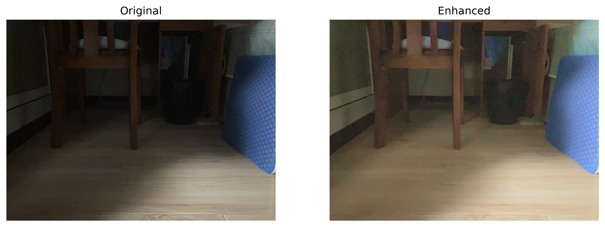

# LOW-LIGHT IMAGE ENHANCEMENT


这是一个 **低照度图像增强** 的项目，面向日常生活中手机/相机拍到的低光照彩色图像，探索一种用**亮度增益量驱动饱和度补偿**方法。

## 效果展示



## 方法

### 想法
**亮度增益驱动饱和度补偿**
- **先验依据**
    - **人眼视觉特性** 人眼对饱和度的感知与环境亮度正相关
    - **色彩恒常性假设** 假设不同亮度的环境光下物体的色调不变
- **演绎**
    - 亮度增强后，需要补偿饱和度以迎合人眼感知特性。单纯增强图像的亮度（例如 LAB 空间中的 L 层）时，图像会“发灰”。

### 实现
#### 色彩空间 
在 LCH 空间操作，增益 lightness 得到 L 增量后，就可以以此驱动补偿 chroma。相比 HSV 或 HSL，LCH 的亮度、饱和度、色度解耦更干净，方便处理。
#### Pipeline
1. `imread` → 读取低光 BGR 图
2. `denoiser` → 前置降噪（NLM）
3. `BGR2LCH` → 转到 LCH 空间
4. `L_boost` + `C_compensate` → 亮度增益 + 饱和度补偿
5. `LCH2BGR` → 转回 BGR
6. `imwrite` → 保存增强图

## 当前状态
v0.0.1，小项目刚刚起步，框架已经搭好了，CLI 接口可以调用。亮度增益和饱和度补偿的算法在用简单的 gamma 和线性增益占位，详见版本说明 [v0.0.1](docs/releases/v0.0.1.md)。

## 快速开始
```bash
pip install -e .
lowlight-enhance examples/input/dark_room.JPG
```

## 项目结构

```
Low-Light-Image-Enhancement/
├── pyproject.toml                  # 项目元信息与依赖配置
├── README.md   
├── LICENSE                         # MIT
├── .gitignore
│   
├── src/lowlight_image_enhance/     # 源码
│   ├── __init__.py
│   ├── pipeline.py                # 主流程
│   ├── denoiser.py                # 降噪
│   ├── lightness.py               # 亮度增益
│   ├── chroma.py                  # 饱和度补偿
│   ├── colorspace.py              # 色彩空间转换
│   ├── metrics.py                 # 评估指标
│   ├── utils.py                   # 工具函数
│   ├── cli.py                     # 命令行入口
│   └── algorithms/                # 处理算法
│       ├── __init__.py
│       └── gamma.py               # Gamma 校正
│
├── tests/                          # 单元测试
├── notebooks/                      # Jupyter Notebook
├── examples/                       # 示例图片
└── docs/                           # 文档
```

## 依赖
### 必需
```
    "numpy >= 1.24",
    "opencv-python >= 4.8",
    "scipy >= 1.10",
    "matplotlib >= 3.7",
```
### 可选
```
    "pytest >= 7.0",
    "jupyter >= 1.0",
    "scikit-image >= 0.21"
```
## 参考资料

## License
This project is licensed under the [MIT License](LICENSE).