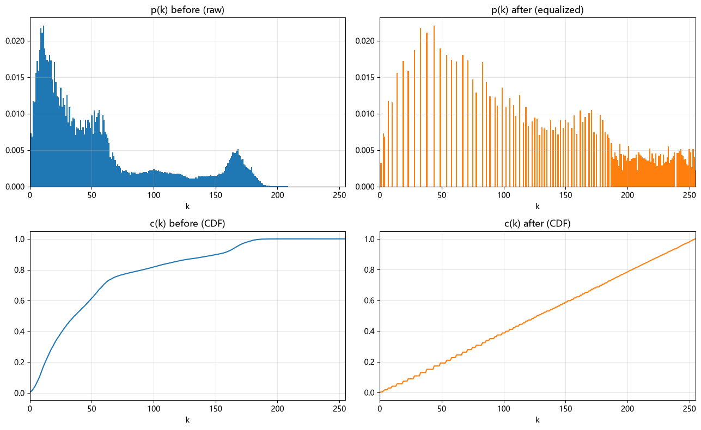

# Histogram Equalization 直方图均衡化

## 思想
拉伸图像的动态范围，增强对比度

## Prior
概率论中的 **概率分布函数** `PDF`，即灰度级 $r_k$ 出现的概率：

$$p(r_k) = \frac{n_k}{N}$$

其中 $n_k$ 是灰度级为 $r_k$ 的像素个数，$N$ 是总像素数。

**累积分布函数** `CDF`，即亮度不超过 $r_k$ 的像素占比（可理解为"排名"）：

$$c(r_k) = \sum_{j=0}^{k} p(r_j)$$

它从 $0$ 单调递增到 $1$。
## HE
通过“抹匀直方图”的方法扩大图像的动态范围，放大对比度。
### 转换公式
根据`CDF`重新分配像素的灰度级，均衡`PDF`：

$$s_k = T(r_k) = (L-1) \cdot c(r_k)$$

其中 $L$ 是灰度级数（如 $L=256$），$L-1$ 是最大灰度值 $255$。即"亮度 $r_k$ 的排名 $c(r_k)$ 被缩放到 $[0, 255]$"。
一个感性的理解是，对于概率密度较高的像素级，在其邻域内的 `CDF` 增长也快，输出的灰度级就会被“拉开”，对应到 `PDF` 上，就是“抹平”不同灰度级概率分布的差异。
### Example
对这张图像的亮度层使用 HE 算法

对比处理前后的 `PDF` `CDF`

## CLAHE（Contrast Limited Adaptive Histogram Equalization）
HE 的优化版本，通过分块（自适应）和限制对比度缓解 HE 局部对比度不足和放大噪声的缺点。
不过这引入了新的问题——块效应，虽然可以线性插值来缓解，但依然有些“不自然”。
