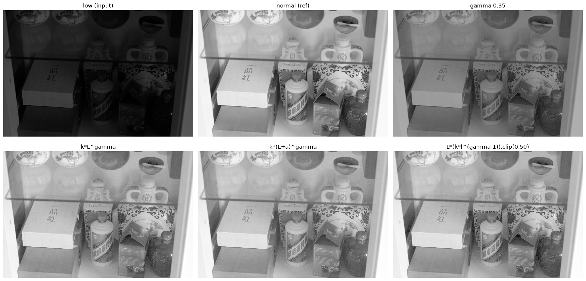

gamma 增益 $ L_o = L_i ^ γ$ 扩大图像动态范围的能力有限，且容易放大噪声。在 gamma 的基础上改进：

$$ L_o = k \cdot (L_i + a) ^ γ $$

其中 `k` 作为放大系数可以扩大图像原有的动态范围，`a` 取小值可以一定程度上减轻噪声放大，`γ` 负责非线性变换，将更多的动态范围分配给暗部。

## 问题：`+a` 的偏移会抹平暗部对比度

实际测试发现 `+a` 的偏移操作会损失一部分暗区的对比度。将 `a` 设置为 0 后，增益后图像的对比度与原正常亮度图相比依然低一些。

实际上 `+a` 的操作更像添加了直流噪声：它弱化/抹平了暗区的对比度，这个负面影响被非线性映射放大，最终减少了一些暗部的信息，画面发灰、不够通透。

## 改进：从增益曲线入手

换一个视角，看看增益曲线。去掉偏移，计算增益 $ L_o / L_i $：

$$ L_o = L_i \cdot \text{gain}(L_i) $$
$$ \text{gain}(L_i) = (k \cdot L_i ^ {γ-1}).clip(0, a) $$

然后限制 gain 的上限，限制过暗像素的增益倍率。

> 注：改进后 `a` 从"偏移量"变成"增益倍率上限"，最终的数学表达其实是暗区一小段线性映射和其余大部分非线性映射的拼接

$$  L_o = \min\left(L_i^\gamma,\ a \cdot L_i\right)  $$

下图展示了 kaga 与参照和传统 gamma 的对比和几步改进的效果。

### 关于增益上限截断导致的直方图割裂
映射曲线的"统一性"决定了输出直方图的连贯性。若映射由多段（如线性 + 幂）硬拼接而成，会在拼接处产生斜率不连续，直方图对应位置会出现割裂/突兀的痕迹。增益上限设得过低（如 a=10）会明显暴露这种拼接；提高到足够高（如 a=50）则映射基本落在单一非线性段，直方图连贯自然。

### 参数自适应
尝试一个简单直观的方法:用目标动态范围确定k。先固定γ，令 k = 1/(L_in.max()^γ)，这样可以把低光照图像的动态范围映射到[min(), 1]，而 LOL 数据集中绝大多数的图像亮度层最暗像素值是 0，这样亮度增益的目标动态范围大概为 [0, 1]。
而实践发现，许多情况下 max() 不能作为低光照图像亮度的动态范围参考，max() 可能包含了高亮度的反光或尖锐的噪声。将动态范围上限参考换为 99.9% 分位数更合适。