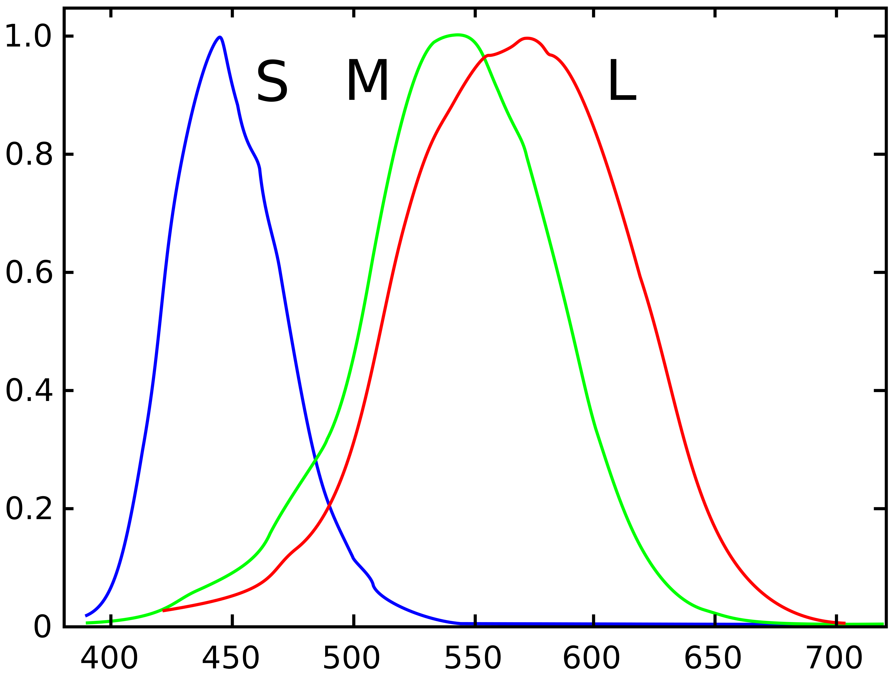
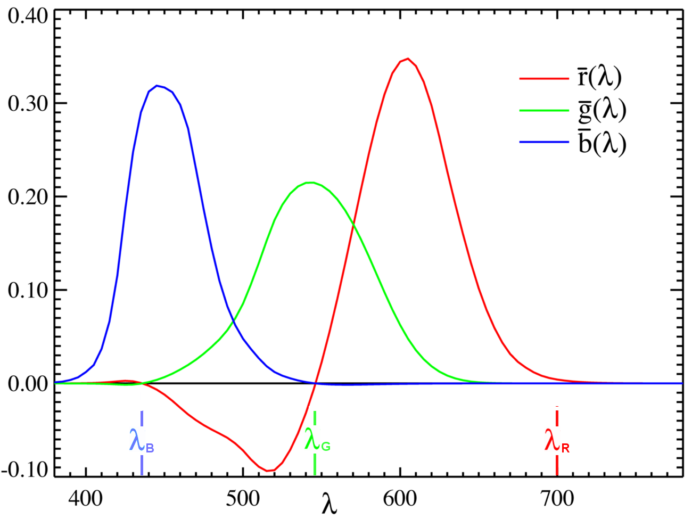
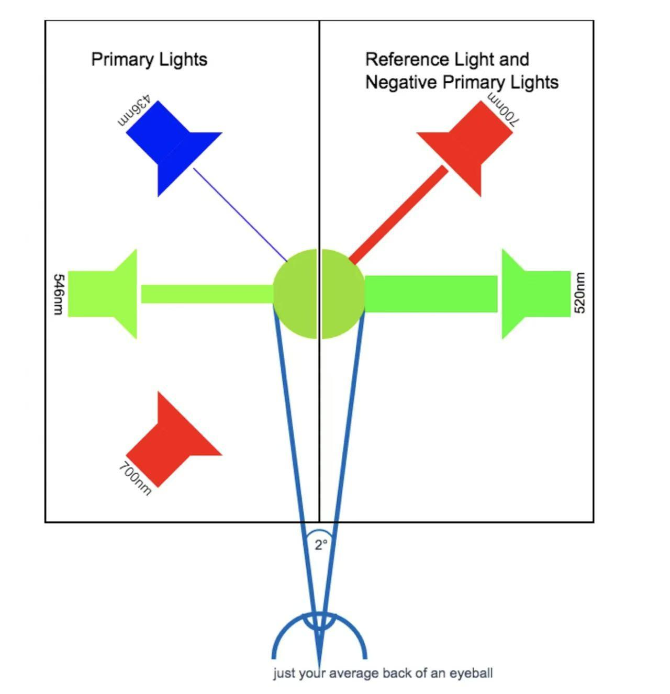
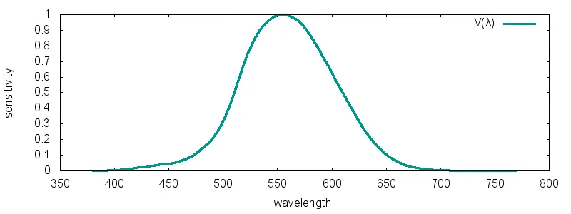

# 色彩空间

## CIE XYZ

### Prior
- **人眼对色彩的感知**
    - **不同波长可见光对三种视锥细胞的刺激** 
    
    - **同色异谱**：不同的光谱能感知为同样的颜色，是 RGB 混色的原理
        - W. David Wright 和 John Guild 的混色实验
            - 结论：大部分颜色都可以用不同强度的三原色R，G，B的混合得到
        - **CIE 1931 混色实验**：一个屏幕成左右两半，左边用 RGB 三种原色光（red 700nm, green 546.1nm, blue 435.8nm）混合，右边是某特定波长 *λ* 的目标色，调整 RGB 三种原色光的占比，直到左右两边的颜色趋于一致，测出了不同波长可见光色彩对应的 RGB 颜色匹配函数：
        
            - **纵轴的单位**：颜色匹配函数 *r(λ), g(λ), b(λ)* 定义为 **匹配 1 W 波长为 *λ* 的光** 的所需的红光、绿光、蓝光的 **数量（以单位计）**。这里的 **匹配** 是指人眼感官上的 **颜色** 和 **亮度** 一致。
                - **基准：EEW 白光与 RGB 1:1:1**：做实验的佬 **希望白光的 RGB 匹配系数是 1:1:1**，可实际上白光（可见光谱上各波长功率都相等的光，EEW 白光）对应的 **RGB 三色光功率比** 并不是 1:1:1，就给 R、G、B 三种原色光配了 **不同大小的功率单位**，使得在这套单位下，**EEW 白光的 RGB 匹配系数在数值上是 1:1:1**
                - **逆向还原**：上图的 RGB 颜色匹配曲线 是被用 WWE 白光 = 1R : 1G : 1B 约束后的基准单位“压缩”过的，如果纵轴换成绝对的物理功率，匹配系数的数值差距极大。
            - ***r(λ)* 的负值是怎么来的？**
                - **发现问题**：波长在 500nm 左右的光的颜色不同，无论怎样混合 RGB 三原色都调不出这种色彩
                - **解决方案（也是 r(λ) 的负值来源）**：把红光照到右边屏幕的目标色上:
                
                这样混光公式就从*r(λ) + g(λ) + b(λ) = Color*变成了 *g(λ) + b(λ) = Color + r(λ)*，移项得到 *-r(λ) + g(λ) + b(λ) = Color*，就有了上图 *r(λ)* 在 500nm 处的负值。
        - **小结**：到此，利用 **颜色匹配函数计算不同波长的 RGB 混色占比**，可以用 得到大部分色彩。
        - **任意光谱的 RGB 匹配系数**
            - **格拉斯曼定律**：人类对色彩的感知（大约）是线性的。- **Ex** 如果两个单色光组成一测试光，观测者感知到的RGB匹配系数，等于两单色光分别被单独观测的RGB匹配系数的和。
            - 所以对于 **任意光谱的颜色匹配系数**，可以通过分别对 *r(λ), g(λ), b(λ)* 在光谱上的积分得到。
- **人眼对亮度的感知**
    - **1924 Luminous Effeciency Function, V()**：人眼对 **亮度** 的感知与可见光的 **波长** 有关，因此 CIE 制定了：
    
    纵轴是人眼感知到的 **亮度**，描述人眼对不同波长可见光 **亮度** 的敏感程度。

## CIE 1931 XYZ color space
- **目的**：避免 CMF 的负值对计算造成的困难，**用数学方式统一表征所有人类能看到的颜色**
- **XYZ含义**：三种 **虚拟原色**，解决了 CMF 的负值问题，但这三种虚拟原色物理上并不存在。
- **伟大的遗产- Y 与亮度信息**： CIE 在设计 XYZ 空间时，用线性变换把人眼的明度视觉灵敏度曲线 *V(λ)* 全部分配给了 *Y* 分量。

## CIE LAB
- **目的**：**感知均匀性“（Perceptual Uniformity）** 和 **解耦亮度与色彩信息**，**正交化** XYZ 空间。
- **LAB含义**：L：亮度信息；A：红-绿色轴，绿(-) -> 红(+)；B：黄-蓝色轴，蓝(-) -> 黄(+)

## CIE LCH
- **目的**：**解耦饱和度与色度信息**，分理出 **饱和度** 信息。
- **LCH含义**：L 与 LAB 中的 L 一致，**CH 是 AB 的极坐标表示**。与 a-b 平面远原点（[0,0]，纯灰度色）的距离 **C (Chroma)** 为 **彩度/饱和度**，极坐标的角度 **H (Hue)** 为 **色相**。

    

