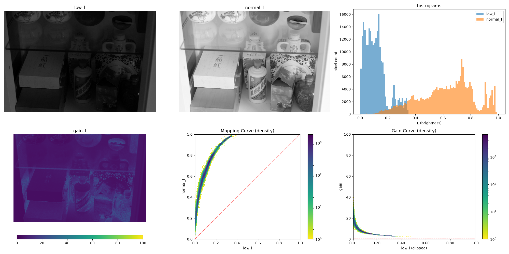

# Analysis - LightnessChange

## 目的
**分析数据集中亮暗样本的 Lightness 差异，寻找亮度增益的规律**

## 脚本
- [analysis.ipynb](../../data/lol/analysis.ipynb) - Jupyter 脚本，调试单张分析图
- [analysis.py](../../data/lol/analysis.py) - Python 脚本，批量生成分析图并统计数据

## 收获

### 分析图



### 增益算法设计思路
#### histogram stretch
观察到 low_l 与 high_l 的直方图形状有关联，将蓝色直方图向右拉伸似乎能得到与橙色直方图相近的形状
#### power
从 mapping curve 观察到 high_l 与 low_l 有类似幂函数的关系

## 遇到的问题

### 跷跷板阈值
为了避免计算 gain _l 时因暗图中的小值引入巨大的增益倍率而污染数据，我对 low_l 进行低位截断，设计了这样的阈值：  
```
LOW_CLIP = 0.01               # low_l 低位截断阈值：低于它的像素无信息，替换为阈值
GAIN_VMAX = 1.0 / LOW_CLIP    # gain_l 统一上限 = 100
```
其中 `GAIN_VMAX` 受 `LOW_CLIP` 影响，这导致阈值不便于调整，太低会引入过多的小值污染数据，调高又会导致截断像素的占比过大。可行的解决方案是将两个阈值解耦，即“计算”与“显示”解耦。  
但直觉告诉我疑惑的原因不只是这个“跷跷板‘阈值，它可能反映出一个真实的问题，关于暗图中极低亮度的像素的处理问题，极暗的像素可能无法通过单纯的乘法操作达到期望的效果，**应用简单增益模型的条件是像素中含有足够盖过噪声的信息**。