# Image Matrix 图像评价指标

拟定研究的指标：PSNR, SSIM/MSSIM, LOE, NIQE

## PSNR

峰值信噪比（Peak Signal-to-Noise Ratio），全参考指标（需要一张"正确"的参照图）。

### 公式

$$
\text{MSE} = \frac{1}{MN}\sum_{i=1}^{M}\sum_{j=1}^{N}\left(I_{ij} - K_{ij}\right)^2
$$

$$
\text{PSNR} = 10\log_{10}\left(\frac{\text{MAX}^2}{\text{MSE}}\right)
$$

- 8 位图：$\text{MAX} = 255$
- 单位：dB

### 关键备注

- **全参考**：需要参照图，把待测图与参照图的差值视为误差/噪声。
- **误差 ≠ 噪声**：只有当待测图 = 干净图 + 噪声（降噪场景）时，差值才是噪声；增强、压缩等场景下差值是"处理偏差"，此时 PSNR 参考价值大打折扣。
- **分子是常数**：$\text{MAX}^2$ 固定 → PSNR 完全由 MSE 决定，与图像内容无关，可跨图、跨算法比较。
- **为什么用理论能量峰值**：是约定满量程为基准，不同内容的图像有统一的基准。

## SSIM

结构相似性（Structural Similarity Index），全参考指标，从"亮度、对比度、结构"三个维度衡量。

### 公式

三个分量：

$$l(x,y) = \frac{2\mu_x\mu_y + C_1}{\mu_x^2 + \mu_y^2 + C_1} \quad \text{（亮度）}$$

$$c(x,y) = \frac{2\sigma_x\sigma_y + C_2}{\sigma_x^2 + \sigma_y^2 + C_2} \quad \text{（对比度）}$$

$$s(x,y) = \frac{\sigma_{xy} + C_3}{\sigma_x\sigma_y + C_3} \quad \text{（结构）}$$

三者相乘（默认 $\alpha=\beta=\gamma=1$）：

$$\text{SSIM}(x,y) = \frac{(2\mu_x\mu_y + C_1)(2\sigma_{xy} + C_2)}{(\mu_x^2 + \mu_y^2 + C_1)(\sigma_x^2 + \sigma_y^2 + C_2)}$$

### 参数

- $\mu$ 均值（亮度）、$\sigma$ 标准差（对比度）、$\sigma_{xy}$ 协方差（结构）
- 稳定常数：$C_1 = (K_1 L)^2$，$C_2 = (K_2 L)^2$，其中 $K_1 = 0.01$、$K_2 = 0.03$，$L$ 为像素动态范围（8 位图为 255，f32 [0,1] 输入取 1.0）
- 简化时取 $C_3 = C_2 / 2$，可消去 $s$ 项

### 关键备注

- 范围 $[-1, 1]$，越接近 1 越像
- 对亮度偏移较宽容：整体提亮后结构不变，SSIM 不会崩（PSNR 会）
- 在局部窗口（常为 11×11 高斯窗）内计算，对所有窗口平均得 **MSSIM**
- 修正了 PSNR"逐像素、不懂结构"的缺陷

### 关于 coding 和 计算

#### 1. 方差 = 平方的均值 - 均值的平方

核心恒等式（用"模糊/平均"算方差的数学依据）：

$$
\text{Var}(x) = E[x^2] - (E[x])^2
$$

推导关键：展开 $(x_i - \mu)^2$ 后，中间两项 $-2\mu x_i + \mu^2$ 的求和**恰好抵消成 $-\mu^2$**，与 N 无关：

$$
\text{Var}(x) = \frac{1}{N}\sum(x_i - \mu)^2
= \frac{1}{N}\sum x_i^2 - \mu^2
= E[x^2] - (E[x])^2
$$

直觉：$E[x^2]$ 先平方会"放大"大数，数据越散它越虚高；$(E[x])^2$ 先平均把差距抹平了。两者之差 = 离散程度。

对应到代码 = **两次模糊**：
- $E[x^2]$：先像素平方，再高斯模糊 → `blur(x * x)`
- $(E[x])^2$：先高斯模糊，再平方 → `blur(x) ** 2`
- 方差 = 两者相减

数字例证：`x = [1, 2, 3, 4]`，定义式算方差 $1.25$，公式算 $7.5 - 6.25 = 1.25$ ✓

#### 2. 滑动高斯窗口的意义

**为什么滑动窗口（局部统计）**
- 整图只算一个 $\mu$、$\sigma$ 会把空间结构抹平（如亮暗分明的图，全局均值会失真）
- 人眼是"局部对比"的：窗口滑过全图 → 每个位置一个 SSIM 值 → 得到 SSIM 地图 → 取平均 = **MSSIM**

**为什么高斯窗（而不是方框窗）**
- 视觉上模拟"中心聚焦、边缘余光"：中心权重高、向边缘平滑递减
- 工程上比方框窗更稳：方框窗在窗口边缘是硬切，易产生块状感、边界敏感
- 高斯窗本质就是一个卷积核，$\mu$、$\sigma$ 是加权统计量 → 用 `GaussianBlur` 即可实现窗口加权平均

#### 3. 小常数 C 的处理

- 作用：给分母垫"地板"，防止暗区（$\mu \approx 0$）/平坦区（$\sigma \approx 0$）时除零爆炸
- $C_1 = (K_1 L)^2$，$C_2 = (K_2 L)^2$，其中 $K_1 = 0.01$、$K_2 = 0.03$，$L$ 为动态范围
- **取平方**是为了和 $\mu^2$、$\sigma^2$ **同量纲**，才能"加在一起比大小"
- $C_3 = C_2 / 2$ 时可消去结构项，合并进公式（约分推导）：

  代入 $C_3 = C_2/2$ 后，$s$ 项分母里的 $\sigma_x\sigma_y + C_2/2$ 恰好是 $c$ 项分子 $2\sigma_x\sigma_y + C_2$ 的 $\frac{1}{2}$，上下约掉公因子：
  $$
  c \cdot s = \frac{(2\sigma_x\sigma_y + C_2)(\sigma_{xy} + C_2/2)}
  {(\sigma_x^2 + \sigma_y^2 + C_2)(\sigma_x\sigma_y + C_2/2)}
  = \frac{2\sigma_{xy} + C_2}{\sigma_x^2 + \sigma_y^2 + C_2}
  $$
  效果：$C_3$ 整个消掉、不再出现；$\sigma_{xy}$ 的系数从 1 变 2；只剩 $C_1$、$C_2$ 两个常数。此时 $C_2$ 一个人同时兜底"对比度"和"结构"的分母。
- 数值直觉（$L = 1.0$）：$C_1 = 10^{-4}$、$C_2 = 9 \times 10^{-4}$——正常区域几乎无影响，只在统计量趋近 0 时兜底

### 思考

**窗口大小与图像分辨率**
实际应用中对 SSIM 的窗口大小与图像分辨率的比例似乎没有明确的要求，这可能导致不同尺寸的图像以不同窗长计算出的 SSIM 有明显差距。当窗口大小与**人眼能感知到结构区域大小**匹配时，SSIM 的参考意义才更大，而图像本身就是多尺度的（例如有远处的大片的山脉，也有近处的小树叶纹理），单一的窗口大小很难同时概括图像中天然的多尺度结构，所以**MS-SSIM**出现了。

